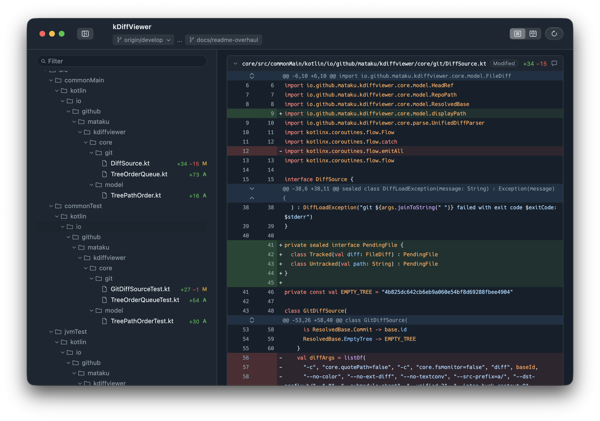
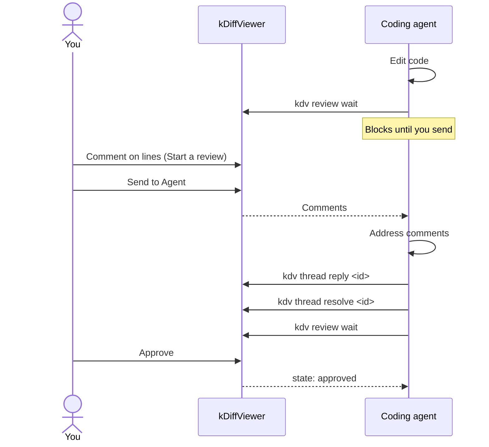

# kDiffViewer



kDiffViewer is a macOS desktop viewer for the git diff of a branch and its working tree, built with Kotlin Multiplatform and Compose Desktop. It shows everything since the branch point, including uncommitted work, in a GitHub-like view, and lets you leave review comments that a coding agent can read and answer from the terminal.

## Features

- One diff of committed, staged, unstaged, and untracked changes against the branch point, in a unified or split view
- A file tree with a filter field that narrows it by path, and collapsible files with sticky headers
- Hidden context lines expand in place, and large diffs stream in as they load; files with 1,000 or more changed lines start collapsed
- Syntax highlighting for Kotlin, Ruby, Go, Rust, Swift, Python, Java, JavaScript (including JSX), TypeScript (including TSX), Markdown, JSON, YAML, HTML, CSS, XML, TOML, and shell scripts (Bash)
- Select and copy code from the diff without line numbers or `+`/`-` markers
- Review comments on lines or line ranges, with GitHub-style Markdown, that coding agents read and answer through the `kdv` command
- System, Light, Dark, and Dim appearances

## Requirements

- macOS. The `kdv` command is built for Apple Silicon only
- macOS 26 or later for syntax highlighting, because the bundled grammar libraries are built for it
- git 2.36 or later at runtime (blobs are read through `git cat-file --batch-command`)
- To build: JDK 25 to run Gradle. The build and the bundled runtime use the JetBrains Runtime 25 toolchain, which Gradle downloads automatically when it is not installed; the custom title bar needs JBR. Homebrew's OpenJDK is not suitable for packaging because it links font libraries from Homebrew into the bundled runtime ([Compose issue #3107](https://github.com/JetBrains/compose-multiplatform/issues/3107))

## Install

There is no prebuilt release; build the app from source:

```sh
./gradlew :app:createDistributable
```

The app is created at `app/build/compose/binaries/main/app/kDiffViewer.app`. Copy it to `/Applications`.

The app bundles the `kdv` command. Link it onto your `PATH`:

```sh
ln -s /Applications/kDiffViewer.app/Contents/app/resources/kdv /usr/local/bin/kdv
```

If `/usr/local/bin` is not writable by your user, run the command with `sudo`, or link `kdv` into another directory on your `PATH` (for example `~/.local/bin`).

## Usage

### Opening a repository

`kdv ./repo` opens a repository in kDiffViewer, and `kdv` with no argument opens the current directory. Bare words are commands (`thread`, `review`, `reload`, `windows`, `agent-guide`), so write relative paths as `./repo`. Run `kdv --help` for the full list. From the app, File ▸ Open… (⌘O) opens a repository with a folder picker.

Any directory inside a repository shows the whole repository's diff. The diff does not reload by itself; press ⌘R or run `kdv reload` after changing files.

### Choosing the base

The diff shows everything since the branch point plus staged, unstaged, and untracked changes, like a pull request that also includes uncommitted work. The base is the merge-base of `HEAD` and the branch `origin/HEAD` points at (usually the repository's default branch, such as `origin/main`); without `origin/HEAD` it is `HEAD`, which shows only uncommitted changes. The toolbar shows the base next to the current branch.

Pass `--base <ref>` to compare against the merge-base with another ref, for example the parent of a stacked branch or a few commits back:

```sh
kdv ./ --base feature-a-base
kdv ./ --base HEAD~3
kdv ./ --base HEAD
```

`--base HEAD` shows only uncommitted changes.

The base can also be changed from the toolbar: click the base tag to open a popup that lists local and remote branches and accepts a typed revision.

## Reviewing with a coding agent

You review a coding agent's changes in the app the way you would review a pull request, and the agent reads and answers your comments from the terminal through the `kdv` command.

To get started, give the agent the instructions that `kdv agent-guide` prints, for example by telling it to run the command or by pasting its output into the agent's instructions file:

```sh
kdv agent-guide
```

A typical round looks like this:



### Leaving comments

<!-- Screenshot: a review comment thread. Planned as docs/images/review-thread.png. -->

Click the add-comment button next to a line to comment on it, or drag the button over several lines to comment on the range. Comment bodies render as GitHub-style Markdown: headings, emphasis, lists, task lists, block quotes, links, and code blocks, with fenced code in the bundled languages syntax-highlighted. Tables and images are not rendered. The composer has Write / Preview tabs; press ⌘⇧P to switch between them.

Comments are kept in memory while the app runs and are not saved, so they are gone after the app quits. When quitting would lose a review, the app asks first.

### Sending comments to the agent

In the composer, Add single comment (⌘⇧↩) sends the comment to the agent right away, while Start a review (⌘↩) keeps it pending, hidden from the agent, so you can collect several comments first. While comments are pending or an agent is waiting, a bar under the diff sends them with Send to Agent, optionally with a message, or tells the agent you are done with Approve.

### The kdv command

A coding agent waits for your review with `kdv review wait`, which blocks until you send comments or approve. It reads threads with `kdv thread list`, answers one with `kdv thread reply`, and marks it done with `kdv thread resolve`; replies show up in the app. Run `kdv agent-guide` for the full instructions to give a coding agent.

## Keyboard shortcuts

| Shortcut | Action |
| --- | --- |
| ⌘O | Open a repository |
| ⌘R | Reload the diff |
| ⌘, | Open Settings |
| ⌃⌘S | Hide or show the sidebar |
| ⌘C | Copy the selected code or comment text |
| ⌘↑ or ⌃Home | Scroll to the top of the diff |
| ⌘↓ or ⌃End | Scroll to the bottom of the diff |
| ⌘↩ | In the composer: start a review, or save an edited comment |
| ⌘⇧↩ | In the composer: add a single comment |
| ⌘⇧P | In the composer: switch between Write and Preview |
| Esc | In the composer: cancel. In the file tree filter: clear it. In the base popup: close it |
| ↩ | In the base popup: compare against the typed revision |
| ↩ or Esc | In the quit confirmation: cancel and keep the app open |

The scroll shortcuts do not apply while a text field or the comment preview has focus; there they keep their usual meaning.

## Settings

Settings… in the application menu (⌘,) changes these, and every change applies immediately:

- Appearance: System, Light, Dark, or Dim
- Diff font family and size, and tab width (2, 4, or 8)
- File tree font size
- Copy on select (off by default)
- The git executable, when the one on `PATH` is not the one you want

<!-- Screenshot: the Dim appearance. Planned as docs/images/appearance-dim.png. -->

Settings are stored in `~/Library/Application Support/kDiffViewer/settings.json`.

## Known limitations

Files that contain multibyte text (for example Japanese) are not syntax-highlighted until a fix in kotlin-tree-sitter ([tree-sitter/kotlin-tree-sitter#78](https://github.com/tree-sitter/kotlin-tree-sitter/pull/78)) is released, and a stack trace is printed for them on each load.

## Opening untrusted repositories

kDiffViewer runs git, and git reads the repository's own `.git/config` and `.gitattributes`, so a directory that was not cloned (a zip, a tarball, a copied `.git`, a nested submodule) can run commands through git's clean filters, exactly as `git status` would. kDiffViewer disables the fsmonitor hook and never runs external diff, textconv or hooks, but it cannot disable filters. Open such directories only after inspecting `.git/config` and `.gitattributes`.

## Development

Run the app from source:

```sh
./gradlew :app:run --args=/absolute/path/to/repo
./gradlew :app:run --args=..
./gradlew :app:run --args="/absolute/path/to/repo --base develop"
```

Gradle runs the app with `app/` as its working directory, so a relative path is resolved from there, not from where you ran `./gradlew`. `--args=..` opens this repository with its own name in the header, while `--args=./` shows the same diff under the name `app`.

`./gradlew check` runs all tests, and CI runs the same on pushes to develop and on pull requests.

## License

MIT
